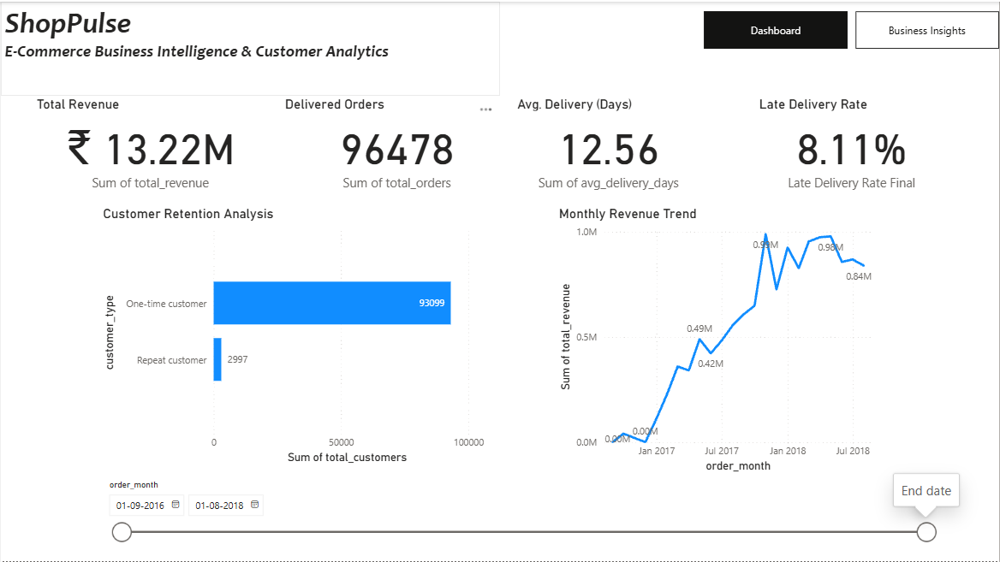

# ***ShopPulse – E-Commerce Business Intelligence \& Customer Analytics***


!\[Project](https://img.shields.io/badge/Project-ShopPulse-blue)

!\[SQL](https://img.shields.io/badge/SQL-PostgreSQL-336791)

!\[Power BI](https://img.shields.io/badge/Visualization-Power%20BI-yellow)

!\[Python](https://img.shields.io/badge/Analysis-Python-3776AB)


**Project Overview**


ShopPulse is an end-to-end E-Commerce Business Intelligence and Customer Analytics project developed to analyze e-commerce sales performance, customer behavior, revenue trends, and delivery efficiency.


The project uses the Brazilian E-Commerce Public Dataset by Olist. SQL and Python are used for data analysis, while Power BI is used to develop an interactive business intelligence dashboard.


The main objective is to transform raw e-commerce data into meaningful business insights that support data-driven decision-making.


**Business Objectives**


\- Analyze overall e-commerce sales and revenue performance.

\- Understand customer purchasing and retention behavior.

\- Identify one-time and repeat customers.

\- Evaluate delivery performance and late-delivery rates.

\- Analyze monthly revenue trends.

\- Provide actionable business recommendations.
 Power BI Dashboard



The interactive dashboard provides insights into revenue performance, customer retention, and delivery efficiency.


&#x20;**Technology Stack**


| Technology | Purpose |

|---|---|

| PostgreSQL | Database management and SQL analysis |

| pgAdmin 4 | Database administration |

| Python | Data quality checks and customer analysis |

| Jupyter Notebook | Exploratory data analysis |

| Power BI | Interactive dashboard and visualization |

| Git \& GitHub | Version control and project management |


&#x20;**Project Structure**


ShopPulse-Ecommerce-Analytics/

│

├── .gitignore

├── README.md

├── requirements.txt

│

├── data/

│   └── raw/

│       ├── product\_category\_name\_translation.csv

│       ├── olist\_customers\_dataset.csv

│       ├── olist\_geolocation\_dataset.csv

│       ├── olist\_order\_items\_dataset.csv

│       ├── olist\_order\_payments\_dataset.csv

│       ├── olist\_order\_reviews\_dataset.csv

│       ├── olist\_orders\_dataset.csv

│       ├── olist\_products\_dataset.csv

│       └── olist\_sellers\_dataset.csv

│

├── docs/

│   ├── data\_dictionary.md

│   └── metric\_definitions.md

│

├── notebooks/

│   ├── 01\_data\_quality.ipynb

│   └── 02\_customer\_analysis.ipynb

│

├── powerbi/

│   └── ShopPulse.pbix

│

├── reports/

│   └── business\_findings.md

│

└── sql/

&#x20;   ├── 01\_create\_tables.sql

&#x20;   ├── 02\_data\_quality.sql

&#x20;   ├── 03\_business\_analysis.sql

&#x20;   └── 04\_validation.sql


&#x20;**Key Performance Indicators (KPIs)**


The project evaluates the following business metrics:


| KPI | Result |

|---|---:|

| Delivered Orders | 96,478 |

| Total Product Revenue | ₹13,221,498.11 |

| Total Freight | ₹2,198,275.64 |

| Average Delivery Time | 12.56 days |

| Late Delivery Rate | 8.11% |

| Unique Customers | 96,096 |

| One-Time Customers | 93,099 |

| Repeat Customers | 2,997 |

| Repeat Customer Rate | 3.12% |


\*Note: These are the verified full-period analysis results. Dashboard values can change when date filters are applied.\*


&#x20;**Power BI Dashboard**


The interactive ShopPulse dashboard contains:


&#x20;1. KPI Overview

\- Total Revenue

\- Delivered Orders

\- Average Delivery Days

\- Late Delivery Rate


&#x20;2. Customer Retention Analysis

Compares one-time customers and repeat customers to understand customer purchasing behavior.


&#x20;3. Monthly Revenue Trend

Visualizes monthly revenue changes over time to identify sales patterns.


&#x20;4. Interactive Date Slicer

Allows users to select a date range and explore changes in relevant dashboard metrics.


&#x20;5. Business Insights

A separate report page presents important findings and business recommendations.


&#x20;**Business Insights**


\### 1. Revenue Performance

The business generated approximately ₹13.22 million in product revenue from delivered orders.


\### 2. Customer Retention

The analysis identified 96,096 unique customers. Only 2,997 customers made repeat purchases, representing approximately 3.12% of unique customers.


\### 3. Delivery Performance

The average delivery time was 12.56 days, while approximately 8.11% of delivered orders experienced late delivery.


&#x20;**Business Recommendations**


\- Introduce customer loyalty programs to encourage repeat purchases.

\- Use personalized marketing campaigns to improve customer retention.

\- Investigate the causes of delayed deliveries.

\- Improve logistics planning and delivery management.

\- Monitor monthly revenue trends to support business planning.


&#x20;**Project Workflow**


1\. Collected and organized the Olist e-commerce datasets.

2\. Performed data quality checks using Python and SQL.

3\. Designed and managed the PostgreSQL database.

4\. Executed SQL queries for business analysis.

5\. Created reusable analytical views and calculated KPIs.

6\. Connected PostgreSQL data to Power BI.

7\. Developed an interactive dashboard.

8\. Identified business insights and recommendations.


&#x20;***How to Run the Project***


&#x20;**Prerequisites**


\- PostgreSQL

\- pgAdmin 4

\- Python 3

\- Jupyter Notebook

\- Power BI Desktop


&#x20;Step 1: Clone the Repository


```bash

git clone <your-github-repository-url>

cd ShopPulse-Ecommerce-Analytics

```


&#x20;Step 2: Install Python Dependencies


```bash

pip install -r requirements.txt

```


&#x20;Step 3: Set Up the Database


1\. Create a PostgreSQL database.

2\. Execute `01\_create\_tables.sql`.

3\. Import the required CSV datasets.

4\. Execute `02\_data\_quality.sql`.

5\. Execute `03\_business\_analysis.sql`.

6\. Execute `04\_validation.sql`.


&#x20;Step 4: Run Python Notebooks


Open the notebooks using Jupyter Notebook:


\- `01\_data\_quality.ipynb`

\- `02\_customer\_analysis.ipynb`


&#x20;Step 5: Open the Power BI Dashboard


Open `powerbi/ShopPulse.pbix` using Power BI Desktop and configure the PostgreSQL connection if required.


&#x20;**Dataset Source**


\*\*Brazilian E-Commerce Public Dataset by Olist\*\*


Source: https://www.kaggle.com/datasets/olistbr/brazilian-ecommerce


The dataset contains information about orders, customers, products, sellers, payments, reviews, and geolocation.


&#x20;**Author**


\*\*Nithish M\*\*


Information Technology Student


Interested in Data Analytics, Business Intelligence, SQL, Python, and Data Visualization.


\---


⭐ If you find this project useful, consider giving the repository a star!

